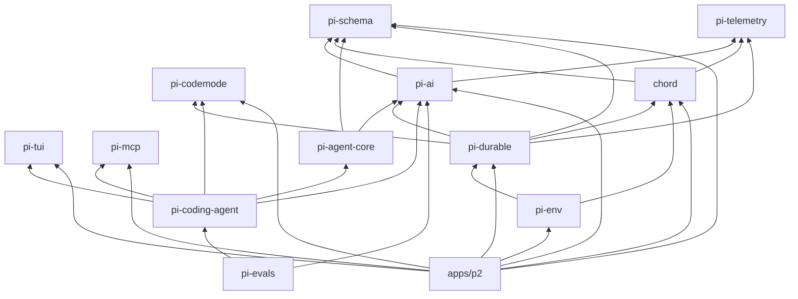

# 架构设计

本文描述 [suntydic/pi](https://github.com/suntydic/pi) 当前 checkout 的结构，供把这份代码改成自己的 agent 时定位改动层。上游产品用法仍以仓库里的英文文档为准，尤其是 [packages/coding-agent/docs/how-pi-works.md](../../packages/coding-agent/docs/how-pi-works.md) 和各包 README。这里只记录源码里已经存在的边界。

快照：工作区包版本 `1.5.1`，Node 要求 `>=22.19.0`（根 `package.json` 的 `engines`）。

## 两条运行时

仓库里有两条可以跑 agent 的栈。它们共享模型层 `@earendil-works/pi-ai`，会话和循环的实现不同。改其中一条不会自动改另一条。

| | 现在发布的 `pi` CLI | Durable / Chord 实验线 |
|---|---|---|
| 产品入口 | `@earendil-works/pi-coding-agent`，命令名 `pi` | `apps/p2` 自托管 UI；`@earendil-works/pi-durable` 库 |
| 循环 | `@earendil-works/pi-agent-core` 的内存循环 | Durable `Harness` 上的任务状态机 |
| 会话 | `SessionManager` 写 JSONL 树 | 存储上的不可变 entry，提交后才对外可见 |
| 进程挂掉时 | 已追加进 JSONL 的记录还在；正在进行的模型请求没有调度器续跑 | `resume()` 从上次检查点继续；死在模型请求中的那次算失败尝试并重试 |
| 谁依赖谁 | coding-agent 依赖 agent-core、pi-ai、pi-tui、pi-mcp、pi-codemode | durable 依赖 chord、pi-ai、pi-codemode、pi-schema、pi-telemetry。p2 的其余边见下图 |
| 稳定性 | CLI 与 SDK 是当前产品 | durable README 标明 API 会在版本间变化；p2 README 标明原型，将被替换 |

`apps/p3` 只有设计笔记（Pi Roam），没有自己的 `package.json`，也没有可启动的宿主。

## 包和依赖

根 `package.json` 的 workspace 是 `packages/*`、`apps/*`，再加上若干示例扩展目录。`npm run build` 按这个顺序构建：telemetry、schema、chord、tui、codemode、mcp、ai、durable、env、agent、coding-agent。p2 不在这条构建脚本里。



箭头表示 package.json 里的 workspace 依赖。`pi-evals` 的两条边是 devDependency，不进 CLI 运行时。`pi-schema`、`pi-telemetry`、`pi-tui`、`pi-codemode`、`pi-mcp` 不依赖其他 workspace 包。

### `@earendil-works/pi-schema`（`packages/schema`）

JSON Schema 的构建器和校验器。schema 编译成普通闭包，不使用 `eval`。pi-ai 用它校验工具参数并描述供应商 schema（`src/utils/validation.ts`、`src/providers/schema-builders.ts`）。chord 用它写对象契约。coding-agent 的内置工具和扩展示例仍常用 TypeBox，校验前会变成 JSON Schema。

### `@earendil-works/pi-telemetry`（`packages/telemetry`）

显式传入的 span / metric 契约，加上内存参考实现和 schema 工具。没有全局 current span，也没有自带导出器。`NOOP_TELEMETRY_CONTEXT` 在没有适配器时丢弃记录。

pi-ai 导出 `AI_TELEMETRY_SCHEMA`。`Models` 发请求时调用 `observeModelRequest`；调用方没传入 span 时走 no-op。当前 CLI 没有把 `TelemetryContext` 接进这条路径。`packages/coding-agent/src/core/telemetry.ts` 只判断安装遥测开关（环境变量 `PI_TELEMETRY` 或 settings），和这套 span 不是同一件事。

Chord 的 `Context` 始终带一个 `TelemetrySpan`。Durable 的异步调用都收这个 `Context`，并用 `DURABLE_TELEMETRY_SCHEMA` 描述自己的 span。

### `@earendil-works/pi-ai`（`packages/ai`）

统一的多供应商 LLM API。根导出（`src/index.ts`）刻意没有副作用：不含生成的目录、供应商工厂、OAuth 实现。工厂在 `@earendil-works/pi-ai/providers/*`，线协议在 `@earendil-works/pi-ai/api/*`，旧的全局 API 在 `@earendil-works/pi-ai/compat`。

一个 `Models` 集合登记若干 `Provider`。一次聊天请求走 `stream` / `streamSimple`（或对应的 `complete`）。模型记录上的 `api` 字段选择具体线协议，例如 OpenAI Chat Completions、OpenAI Responses、Anthropic Messages、Google、Bedrock Converse。供应商目录由 `packages/ai/catalog` 生成到 `src/models.generated.ts`；`src/providers/data/` 是生成的模型数据，被 gitignore。内置供应商名单以 `src/providers/all.ts` 为准，覆盖 OpenAI、Anthropic、Google、Bedrock、OpenRouter 以及一批 OpenAI/Anthropic 兼容端点。测试用 `faux` provider，不打真实网络。

认证在 `src/auth/`：凭证存储、OAuth 刷新、环境变量。`ModelRuntime`（coding-agent）和 `Harness`（durable）都是这层上面的调用方。

### `@earendil-works/pi-agent-core`（`packages/agent`）

有状态的 agent。源码只有 `agent.ts`、`agent-loop.ts`、`types.ts`、`proxy.ts`、`stream-fn.ts`。它知道工具调用和事件，不知道文件、终端、JSONL 会话。`streamFn` 由调用方注入，CLI 注入的是 `ModelRuntime` 包过的 pi-ai 流。

`AgentMessage` 可以比 LLM 消息更宽（含应用自己的消息类型）。发给模型之前经过两步：可选的 `transformContext`，然后必须的 `convertToLlm`。LLM 只看 `user`、`assistant`、`toolResult`。

### `@earendil-works/pi-tui`（`packages/tui`）

终端组件库：差分渲染、主屏/备用屏、编辑器、Markdown、选择列表。组件实现 `render()`。原生剪贴板在 `native/darwin`、`native/linux`、`native/win32`。它不包含 agent 逻辑。coding-agent 的交互模式用它画界面；p2 的终端面也依赖它。Chord 另有 `@earendil-works/chord/tui`，那是 Chord 应用的终端沙箱，不是这个包。

### `@earendil-works/pi-mcp`（`packages/mcp`）

独立的 Model Context Protocol 客户端：stdio、Streamable HTTP、以及给外部拉起进程用的 pipe。不依赖官方 MCP SDK，也不依赖其他 pi 包。coding-agent 通过内置、可被替换的 `mcp` 扩展使用它。Durable 一侧由 p2 的 `mcp` 插件和 pi-env 的进程管道使用。

### `@earendil-works/pi-codemode`（`packages/codemode`）

在 QuickJS（WASM）里跑模型写的 JavaScript。沙箱没有 Node、文件系统、网络和定时器；对外能力只有注入的工具。嵌套工具调用不进入 LLM 上下文，只有脚本输出和返回值进入。Node/Bun 用 `CodemodeSandbox`（每次执行一个 worker 线程）；Cloudflare 用 `RemoteCodemodeSandbox`。coding-agent 把它做成可替换的内置扩展 `codemode`。durable 通过 `@earendil-works/pi-durable/codemode` 再包一层。

### `@earendil-works/pi-coding-agent`（`packages/coding-agent`）

当前的 coding agent CLI 和进程内 SDK。`bin.pi` 指向构建后的 `dist/bundle/cli.js`。源码入口是 `src/cli.ts`：`setupCli()` 然后 `main()`。`src/index.ts` 是库导出，`createAgentSession` 在 `src/core/sdk.ts`。

它拥有：内置工具、系统提示、JSONL 会话、扩展加载、四种运行模式、模型运行时、项目信任。它不 import chord 或 durable。

内置工具定义在 `src/core/tools/`，`createAllToolDefinitions` 一次建出 `read`、`bash`、`edit`、`write`、`grep`、`find`、`ls`、`powershell`。没有 `--tools` 白名单时它们都留在工具表里。默认活动名单来自 settings 的 `defaultTools`；未配置时是 `read`、`bash`、`edit`、`write`（`DEFAULT_TOOL_NAMES`）。其余工具要被选进活动名单后才声明给模型。

进程内扩展由 `src/core/extensions/` 加载。随二进制带上的内置扩展在 `src/extensions/index.ts`：`llama.cpp`、以及可被同名注册替换的 `codemode`、`tool-search`、`mcp`。

### `@earendil-works/chord`（`packages/chord`）

跨进程的对象运行时。对象类型是带 JSON Schema 的契约；插件用 facet 声明自己在某个 host 上服务的类型和对 registry 的贡献；调用方拿到的是引用。文档（document）是对象拥有的 JSON，在事务里写，落在 Chord store。每次调用带 principal。插件可以在进程仍运行时按 host 热替换。

设计全文是 `packages/chord/docs/design.md`。入口按运行环境拆开：核心在包根，HTTP / workers / plugins / app 在 Node 子路径，web / react / tui 是客户端面。可选 peer 是 `esbuild`、`ws`、`react`。

### `@earendil-works/pi-durable`（`packages/durable`）

实验中的持久 agent harness，建在 pi-ai 和 chord 上。`Harness.open(storage)` 打开一个 session。`root()` 返回根对话。`submit({ type: "input", content })` 先把输入持久化，再由内置任务 `pi.generation` 调模型。工具调用是该 generation 拥有的 `pi.tool` 任务。一次 commit 里可以同时追加 entry、改 document、建 task，要么全部落盘，要么全部不落。

存储后端：内存、JSONL、SQLite（Node 与 Cloudflare）、IndexedDB，以及 Chord store（`./storage/store`）。工具通过 `ExecutionEnv` 碰文件系统和进程；本机实现在 `./env` 的 Node 适配，远程机器走 `@earendil-works/pi-env`。

### `@earendil-works/pi-env`（`packages/env`）

给 Durable 用的远程执行环境。`daemon/` 是 Rust 程序，在远端用 stdin/stdout 帧协议做文件和命令。`RemoteExecutionEnv` 实现 Durable 的 `ExecutionEnv`。SSH 部署、主机密钥和协议分别在包 README、`docs/semantics.md`、`docs/protocol.md`。

### `@earendil-works/pi-evals`（`packages/evals`）

私有评测包，用 vitest-evals 跑 coding-agent 行为。需要 `PI_PROVIDER` 和 `PI_MODEL`。根脚本是 `npm run eval`。它不参与 CLI 运行时。

### `apps/p2`

Chord 插件组成的自托管 Durable UI。宿主入口：`src/hosts/server.ts`（`npm start`）、`src/hosts/tui.ts`（`npm run tui`）。插件在 `apps/p2/plugins/`（sessions、agent、coding-tools、mcp、terminals、subagents 等）。数据目录默认 `~/.pi/p2`。README 写明这是原型。写插件前要读 `apps/p2/docs/plugin-practices.md`。p2 不在根 `npm run check` 里，要单独 `cd apps/p2 && npm run check`。

## CLI 里一次请求怎么走

交互模式是这条链。print、JSON、RPC 在进入 `AgentSession.prompt` 之后使用同一套 session 和 agent。

```mermaid
sequenceDiagram
  participant User as 用户
  participant Mode as InteractiveMode
  participant Session as AgentSession
  participant Ext as 扩展
  participant Agent as pi-agent-core Agent
  participant Loop as agentLoop
  participant AI as pi-ai Models
  participant Disk as SessionManager JSONL

  User->>Mode: 编辑器提交文本
  Mode->>Session: prompt(text)
  Session->>Ext: 斜杠命令或 input 事件
  Session->>Session: 展开 /skill: 与 prompt template
  Session->>Ext: before_agent_start
  Session->>Agent: prompt(messages)
  Agent->>Loop: runLoop
  Loop->>Loop: prepareRequest / transformContext / convertToLlm
  Loop->>AI: streamFn
  AI-->>Loop: assistant 流
  Loop->>Loop: 执行 tool call
  Session->>Disk: 订阅事件并 appendMessage
  Loop-->>Session: agent_end
  Session->>Session: 重试、压缩、agent_before_settle
  Session-->>Mode: AgentSession 事件
```

对应源码：

1. `src/cli.ts` 调用 `setupCli()`（进程标题、`PI_CODING_AGENT`、undici dispatcher），再调用 `src/main.ts` 的 `main(argv)`。
2. `main` 解析参数。`resolveAppMode` 的规则：显式 `rpc` / `json` 优先；`--print`、或 stdin/stdout 不是 TTY，则进入 print；否则 interactive。
3. 启动路径创建 `SettingsManager`、`ModelRuntime`、项目信任，再 `createAgentSession()`。交互模式构造 `InteractiveMode`，编辑器提交时调用 `session.prompt`。
4. `AgentSession.prompt`（`src/core/agent-session.ts`）先处理扩展斜杠命令。然后跑 `input` 处理器，再展开 `/skill:name` 和 prompt template。若已经在流式输出，调用方必须指定 `streamingBehavior`：`steer` 或 `followUp`，消息进入对应队列。
5. 空闲时 `_startRun` → `_prepareRun`：必要时先压缩，发出 `before_agent_start`，组装用户消息和系统提示补丁，然后 `this.agent.prompt(messages)`。
6. `Agent.prompt` 进入 `agentLoop`。循环结束之后，`_handlePostAgentRun` 还可以再 `continue()`：可重试错误、压缩、或 `agent_end` 期间新入队的消息。接着若有 `agent_before_settle` 且决定继续，再 `continue()` 一次。然后发出 settled。

`AgentSession` 订阅 agent 事件，把最终消息、模型切换、思考级别、压缩、自定义 entry 交给 `SessionManager` 追加。模型上下文以 `SessionManager` 的活动分支为准；直接改 `agent.state.messages` 不会替换已持久化的上下文（SDK 文档写明这一点）。

## Agent 循环

实现在 `packages/agent/src/agent-loop.ts` 的 `runLoop`。

外层循环处理 follow-up：内层已经停、但 `getFollowUpMessages()` 还有消息时，把它们当作下一轮的待发送消息。内层循环处理工具调用和 steering。

每一轮在调用模型之前：

- 若上一轮已结束，先 `prepareNextTurn`。
- 把上一轮准备出的消息和 steering 队列写进上下文，并发出 `message_start` / `message_end`。
- `prepareRequest` 可以替换本轮的 context、model、thinking level。它不负责再读队列。
- `declareToolChanges` 比较「当前可执行工具」和「转录里已经向模型声明的工具」，差量写成 system 消息上的 `toolsAdded` / `toolsRemoved`。
- `transformContext` 在 `AgentMessage[]` 上改写（coding-agent 用它投影隐藏工具声明和强制系统提示）。
- `convertToLlm` 得到 pi-ai 的 `Message[]`。
- `streamFn` 发出 assistant 流。事件类型包括 `message_update`。

assistant 的 `stopReason` 为 `error` 或 `aborted` 时，循环在 `finishTurn` 和 `turn_end` 之后结束。`stopReason === "length"` 且带有 tool call 时，不执行这些调用，而是全部记为失败（参数可能被截断）。

其他带 tool call 的回复进入 `executeToolCalls`。默认 `toolExecution` 是 `parallel`：预检按顺序，允许的工具并发执行，`tool_execution_end` 按完成顺序发出，但写回的 toolResult 仍按 assistant 原文顺序。任何一个工具声明 `executionMode: "sequential"` 时，这一批全部改为顺序执行。`beforeToolCall` 在 `tool_execution_start` 和参数校验之后运行，可以拦截。`afterToolCall` 在执行完成、发出结束事件之前运行。全部结果都带 `terminate: true` 时，循环不再因为这批工具自动再请求模型。

`finishTurn` 返回 `{ action: "end" }` 会在 `turn_end` 后停止，不再取 steering / follow-up。返回 `{ action: "continue" }` 保证至少再有一次模型请求。`error` 和 `aborted` 忽略这个决定。

steering 在当前 assistant 回合之后进入内层循环。follow-up 在 agent 本会停止时进入外层循环。`Agent.abort()` 只中止当前 run 的 `AbortSignal`。交互模式要把队列还给编辑器时，先调用 `InteractiveMode.restoreQueuedMessagesToEditor`（清空 steering 和 follow-up，写回编辑器），再 `session.abort()`。

## 模型层

`ModelRuntime`（`packages/coding-agent/src/core/model-runtime.ts`）持有一个 pi-ai `Models`。它登记内置供应商，读 `models.json` 里的兼容端点和覆盖，并把凭证从 `auth.json` 接到 provider。`streamFn` 从这里来。虚拟模型在真正发请求前由 `resolveModel` 选一个物理模型和思考级别；选择记录在会话的 `model_change`，assistant 消息上写的是实际回答的物理模型。

`packages/ai/src/providers/<name>.ts` 是供应商：认证、模型列表、把请求交给某个 `api`。`packages/ai/src/api/*.ts` 是线协议。新增一种已支持的 API，优先改 `models.json` 或写一个注册 provider 的扩展；新的线协议才改 `api/`。目录生成不要手改 `models.generated.ts`，改 `packages/ai/catalog/` 再跑生成脚本。

思考级别由模型能力夹紧（`clampThinkingLevel`）。请求身份默认带 pi 的 attribution（`DEFAULT_AGENT_IDENTITY`），调用方可以覆盖。

## 界面

四种模式都在 `packages/coding-agent/src/modes/`：

| 模式 | 入口 | 行为 |
|---|---|---|
| interactive | `InteractiveMode` | pi-tui 组件树：聊天视口、编辑器、页脚、对话框。订阅 `AgentSession` 事件增量绘制 |
| print | `runPrintMode` | 跑完一条提示，写出最终回复 |
| json | print 的 JSON 输出 | agent 事件写成 JSONL |
| rpc | `runRpcMode`，独立入口 `src/rpc-entry.ts` | stdin/stdout 上的 JSONL 命令。同进程的 TypeScript 调用方用导出的 `RpcClient` |

交互模式的主题在 `src/modes/interactive/theme/`。组件在 `src/modes/interactive/components/`。键位默认来自 pi-tui 和 coding-agent 的 keybinding 表，用户文件是 `<agent-dir>/keybindings.json`。

SDK 路径不经过 `main.ts`：宿主直接 `createAgentSession()` 再 `session.prompt()`。会话、工具、扩展、模型解析与 CLI 相同。

## 会话和本地状态

`SessionManager`（`src/core/session-manager.ts`）把会话写成 JSONL。当前版本常量是 `CURRENT_SESSION_VERSION = 3`。第一行是 `type: "session"` 的头（id、cwd、时间、可选的 parentSession）。之后每条 entry 有 `id` 和 `parentId`，构成树。活动分支是从根到当前叶的路径。从较早的 entry 继续会在同一文件里长出另一支。fork / clone 把选中的历史复制到新文件。

压缩写入 `type: "compaction"` 的 entry（摘要、`firstKeptEntryId`、token 数）。之后重建模型上下文时，摘要替代更早的消息；原 entry 仍留在树里。还有 `message`、`model_change`、`thinking_level_change`、`usage`、`branch_summary`、`custom` 等类型。格式说明见 `packages/coding-agent/docs/session-format.md`。

默认路径（`src/config.ts`，`piConfig.configDir` 为 `.pi`）：

| 路径 | 内容 |
|---|---|
| `~/.pi/agent/` | agent 目录。`PI_CODING_AGENT_DIR` 可改 |
| `settings.json` / `keybindings.json` / `models.json` / `auth.json` / `mcp.json` | 用户设置、键位、端点、凭证、MCP |
| `extensions/` `skills/` `prompts/` `themes/` | 用户资源 |
| `AGENTS.md`（及 `AGENTS.override.md`、`CLAUDE.md` 等候选名，目录内取第一个存在的） | 全局指令，进入系统提示 |
| `SYSTEM.md` / `APPEND_SYSTEM.md` | 替换或追加系统提示 |
| `sessions/--<编码后的 cwd>--/<时间>_<id>.jsonl` | 会话文件。`PI_CODING_AGENT_SESSION_DIR` 可改目录 |

项目目录 `.pi/` 在项目信任通过之后才加载扩展、技能、提示模板、主题、项目 settings 和项目 MCP。`sessionDir` 是信任解析前就会读的例外，用来找到会话文件。项目已信任且存在 `.pi/SYSTEM.md` 或 `.pi/APPEND_SYSTEM.md` 时，用项目文件，否则用 agent 目录里的同名文件（`discoverSystemPromptFile`、`discoverAppendSystemPromptFile`）。两份不同时拼接。工具和扩展以启动 `pi` 的用户权限运行；仓库没有内建的文件系统或网络沙箱。隔离方式写在 `packages/coding-agent/docs/containerization.md`。

系统提示由 `src/core/system-prompt.ts` 从基础说明、选中的工具、技能清单、上下文文件和 cwd 拼出。技能正文默认不进提示，只放名字和描述；`/skill:name` 或模型读技能文件时才载入全文。提示的结构化段落有差异才写一条新的 system 消息，避免每轮重复整段提示。

## Durable 线的请求

和 CLI 并列，供以后如果要做可崩溃恢复的宿主时对照。规范在 `packages/durable/docs/spec.md`，概念说明在包 README。

```text
submit(input) → pi.user
  pi.generation → pi.system（提示或工具变了才写）, pi.assistant（工具调用）
    pi.tool × n → pi.tool-result × n
  pi.generation → pi.assistant（最终回答）→ submission done
```

`Harness` 是打开的存储加上在上面跑任务的调度器。`Conversation` 是转录，句柄本身不持有状态。entry 不可变。模型看到的是最近一次 `pi.reset` 之后的 entry。每个对话的模型选择存在 document `pi.agent`，按名字对应当前进程的 registry，每次使用时再解析。其他内置 document：`pi.provider`（给供应商的会话身份）、`pi.live`（正在跑的 generation 和工具）、`pi.inbox`（排队的 submission）、`pi.usage`（花费）。

扩展用 `defineExtension`：工具、系统提示 section、hook、wrap、自定义 task。这和 coding-agent 的 `ExtensionAPI` 不是同一套类型。

p2 把这套 harness 放进 Chord worker，浏览器和终端通过 Chord 的 web/tui surface 连上。插件之间只通过对象契约和 registry 通信。

## 二次开发时改哪一层

按想改变的行为选层，避免在错误的包里复制一套循环。

| 想改变的行为 | 看哪里 |
|---|---|
| 斜杠命令、工具名单、系统提示、会话树、交互界面 | `packages/coding-agent` |
| 一轮里何时再请求模型、工具并行、steer/follow-up | `packages/agent`。CLI 会跟着变 |
| 供应商、线协议、模型目录、OAuth | `packages/ai` |
| 终端控件、差分渲染、剪贴板 | `packages/tui`，再接到 `modes/interactive` |
| 在不改循环的前提下加工具、命令、供应商 | coding-agent 扩展。见占位文档 [extension-points.md](extension-points.md) |
| 崩溃后续跑、多进程、插件热替换 | `packages/durable` 和 `packages/chord`。p2 是现成的组装例子，p3 文档是后续方向 |
| 工具在另一台机器上执行 | `packages/env`，只服务于 Durable 的 `ExecutionEnv` |

把 CLI 换成自己的产品名时，`packages/coding-agent/package.json` 的 `piConfig.name` 和 `piConfig.configDir` 会改变 `APP_NAME`、环境变量前缀和配置目录（`src/config.ts` 读取它们）。这是配置点，不是另一套运行时。
